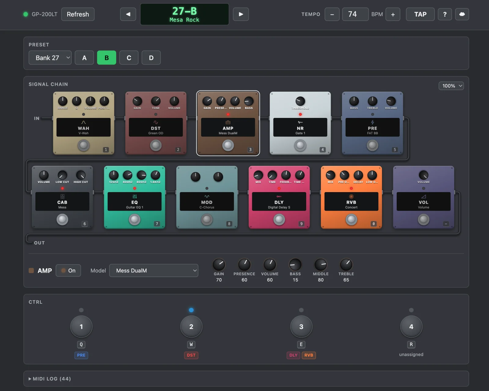

# open-gp200

An open-source editor for the **Valeton GP-200LT** guitar multi-effects pedal that runs in your browser.

Plug the pedal into your computer over USB, open the page, and you can see and control what the pedal is doing: which preset is loaded, which effects are on, which models they use, and the tempo. Changes you make on the pedal itself show up in the browser straight away, so the screen and the pedal stay in sync.

**Try it: https://dianw.github.io/open-gp200/**

No install, no account, no server. The page talks to the pedal directly through your browser's MIDI support.

## What it can do

- **Presets:** see the current preset and switch to any of the 256 slots.
- **Effects:** see all 11 blocks (PRE, WAH, DST, AMP, NR, CAB, EQ, MOD, DLY, RVB, VOL) with the model each one uses, and turn them on or off.
- **Tempo:** read and set the preset's BPM, or tap it in with a button or the T key.
- **CTRL 1-4:** press the pedal's assignable CTRL switches from the screen (still being tested).
- **Live sync:** footswitch presses, effect toggles, model changes and renames on the pedal update the page.
- **MIDI log:** an optional panel that shows every message going back and forth, for the curious.

## What's coming

The aim is a full editor, step by step:

1. Browse the names of every stored preset.
2. Turn effect knobs live.
3. Change effect models and reorder the signal chain.
4. Save and rename presets.

## What you need

- A Valeton GP-200LT. It's tested on firmware 1.8.0. Other GP-200 models may partly work but haven't been tried.
- A USB cable to your computer.
- A Chromium-based browser with Web MIDI (Chrome, Edge, Brave). Safari and Firefox don't support Web MIDI.

Allow MIDI access when the browser asks.

## Running it

Open **https://dianw.github.io/open-gp200/** in a supported browser with the pedal plugged in.

To run it on your own machine instead, see [CONTRIBUTING.md](CONTRIBUTING.md).

## Disclaimer

This is an independent project, not made by or affiliated with Valeton. Reading and switching presets is safe; features that write to the pedal's memory will be clearly marked when they arrive. Back up presets you care about with the official app.

## License

[MIT](LICENSE)
